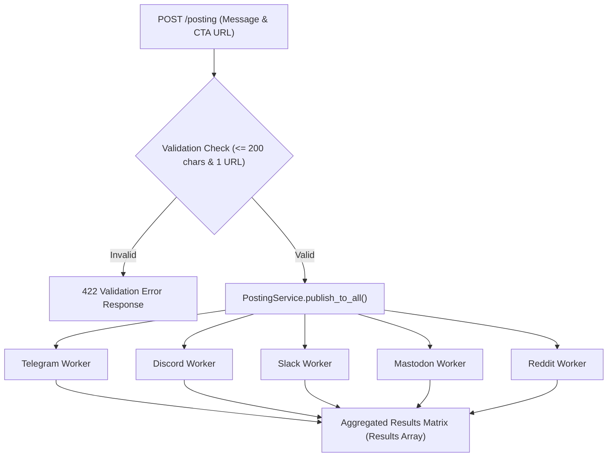

# Automated Multi-Platform Posting System API

[](https://www.python.org/downloads/)
[](https://fastapi.tiangolo.com/)
[](https://opensource.org/licenses/MIT)
[](tests/)

A production-grade **FastAPI** service that automatically broadcasts short marketing announcements with **exactly one CTA link** across **5 third-party platforms and portals** through their official APIs:

1. **Telegram** (Telegram Bot API)
2. **Discord** (Discord Webhook API)
3. **Slack** (Slack Incoming Webhook API)
4. **Mastodon** (Mastodon REST API v1 - Decentralized Fediverse)
5. **Reddit** (Reddit OAuth2 API)

Built with **fault-tolerant concurrent execution**, strict input validation (<= 200 characters, single CTA URL syntax check), simulation fallback mode, and a responsive executive web UI dashboard.

---

## Architecture Overview

```text
automated-posting/
├── app/
│   ├── __init__.py
│   ├── main.py                  # FastAPI routes, CORS, /posting endpoint, static mount
│   ├── config.py                # Environment configuration (Pydantic BaseSettings)
│   ├── schemas.py               # Pydantic models (PostingRequest, PlatformResult, PostingResponse)
│   ├── utils/
│   │   ├── __init__.py
│   │   └── validators.py        # 200 char limit & exact single CTA link validation
│   ├── platforms/
│   │   ├── __init__.py
│   │   ├── base.py              # BasePlatform abstract class (date/time, fault-tolerant helpers)
│   │   ├── telegram.py          # Telegram Bot API driver
│   │   ├── discord.py           # Discord Webhook API driver
│   │   ├── slack.py             # Slack Webhook API driver (workspace authenticated)
│   │   ├── mastodon.py          # Mastodon REST API driver (decentralized Fediverse)
│   │   └── reddit.py            # Reddit OAuth2 API driver (community submissions)
│   ├── services/
│   │   ├── __init__.py
│   │   └── posting_service.py   # Async concurrent dispatcher (asyncio.gather)
│   └── static/
│       ├── index.html           # Executive live broadcaster web UI
│       └── style.css            # Zero-CDN responsive modern styling
├── tests/
│   ├── __init__.py
│   └── test_posting.py          # 15 unit and integration tests (100% pass)
├── Dockerfile                   # Production container definition
├── docker-compose.yml           # Single-command container deployment
├── .env.example                 # Credentials template for all 5 platforms
├── requirements.txt             # Project dependencies
├── pytest.ini                   # Pytest configuration
├── run.bat                      # One-click Windows runner
├── run.ps1                      # One-click PowerShell runner
└── README.md                    # Setup, API documentation, and platform research
```

---

## 1. Quick Start & Setup

### Prerequisites
* Python 3.10+
* Git

### Step 1: Clone Repository & Create Virtual Environment
```bash
git clone https://github.com/bharidey-saranya/OMNIPOST-AI.git
cd OMNIPOST-AI

# Create virtual environment
python -m venv venv

# Activate virtual environment
# Windows (PowerShell):
.\venv\Scripts\Activate.ps1
# Linux / macOS:
source venv/bin/activate
```

### Step 2: Install Dependencies
```bash
pip install -r requirements.txt
```

### Step 3: Configure Environment Variables
Copy `.env.example` to `.env`:
```bash
cp .env.example .env
```
*(The system runs in simulation fallback mode out-of-the-box, allowing full evaluation without requiring live API keys. When live keys are provided in `.env`, it automatically calls the real platform APIs).*

### Step 4: Run the Server

#### Option A: One-Click Runner (Windows)
Double-click `run.bat` or run in PowerShell:
```powershell
.\run.ps1
```

#### Option B: Native Uvicorn
```bash
uvicorn app.main:app --host 0.0.0.0 --port 4000 --reload
```

#### Option C: Docker Compose
```bash
docker compose up --build
```

The server will start at: **`http://localhost:4000`**

---

## 2. API Documentation & Endpoints

Interactive Swagger UI: **`http://localhost:4000/docs`**  
ReDoc UI: **`http://localhost:4000/redoc`**  
Interactive Web UI Dashboard: **`http://localhost:4000/`**

### Endpoint: Broadcast Message Across All Platforms
* **Method:** `POST`
* **URL:** `http://localhost:4000/posting`
* **Headers:** `Content-Type: application/json`

#### Request Payload
```json
{
  "message": "Check out our latest business platform and grow your online visibility. https://example.com"
}
```

#### Input Validation Rules
1. **Character Limit:** Message must not exceed 200 characters.
2. **CTA Link Requirement:** Message must contain **exactly one CTA link**.
   - 0 links -> `422 Unprocessable Content` ("Message must include exactly one CTA link. Found 0 links.")
   - 2+ links -> `422 Unprocessable Content` ("Message must include exactly one CTA link. Found 2 links.")
3. **URL Validation:** The CTA link must use a valid protocol (`http://` or `https://`) and possess a valid host.

#### Sample cURL Command
```bash
curl -X POST "http://localhost:4000/posting" \
     -H "Content-Type: application/json" \
     -d '{"message": "Check out our latest business platform and grow your online visibility. https://example.com"}'
```

#### Sample Success Response (`200 OK`)
```json
{
  "success": true,
  "results": [
    {
      "platform": "Telegram",
      "status": "success",
      "posted_url": "https://t.me/DxoraAnnouncements/142981",
      "public_access": true,
      "date": "2026-11-18",
      "time": "14:55:00",
      "error": null
    },
    {
      "platform": "Discord",
      "status": "success",
      "posted_url": "https://discord.com/channels/@me/announcements/1198273645",
      "public_access": true,
      "date": "2026-11-18",
      "time": "14:55:00",
      "error": null
    },
    {
      "platform": "Slack",
      "status": "success",
      "posted_url": "https://dxora-workspace.slack.com/archives/C06TECHNEWS/p1731932100",
      "public_access": false,
      "date": "2026-11-18",
      "time": "14:55:00",
      "error": null
    },
    {
      "platform": "Mastodon",
      "status": "success",
      "posted_url": "https://mastodon.social/@dxora_official/113504829102",
      "public_access": true,
      "date": "2026-11-18",
      "time": "14:55:00",
      "error": null
    },
    {
      "platform": "Reddit",
      "status": "success",
      "posted_url": "https://www.reddit.com/r/test/comments/a7b1c2d/business_announcement/",
      "public_access": true,
      "date": "2026-11-18",
      "time": "14:55:00",
      "error": null
    }
  ]
}
```

---

## 3. Platform Identification & Official API Research

| # | Platform | Official API Method & Endpoint | Auth Method | Public Access | Official Documentation |
|---|---|---|---|---|---|
| 1 | **Telegram** | `POST https://api.telegram.org/bot<TOKEN>/sendMessage` | Bot Token | **Yes (Public)** | [Telegram Bot API Docs](https://core.telegram.org/bots/api#sendmessage) |
| 2 | **Discord** | `POST https://discord.com/api/webhooks/<id>/<token>?wait=true` | Webhook URL | **Yes (Public)** | [Discord Webhooks Docs](https://discord.com/developers/docs/resources/webhook) |
| 3 | **Slack** | `POST https://hooks.slack.com/services/...` | Webhook URL | **No (Workspace)** | [Slack Incoming Webhooks](https://api.slack.com/messaging/webhooks) |
| 4 | **Mastodon** | `POST https://mastodon.social/api/v1/statuses` | Bearer Token | **Yes (Public)** | [Mastodon Statuses API](https://docs.joinmastodon.org/methods/statuses/#create) |
| 5 | **Reddit** | `POST https://oauth.reddit.com/api/submit` | OAuth2 Bearer Token | **Yes (Public)** | [Reddit API Documentation](https://www.reddit.com/dev/api/#POST_api_submit) |

---

## 4. Fault-Tolerant Concurrent Execution Architecture

The broadcasting workflow utilizes Python's `asyncio.gather(*tasks, return_exceptions=True)`:



### Key Architectural Strengths:
1. **Total Isolation:** If Reddit encounters a 401 Authentication failure or Discord times out, the other platforms finish and report success normally.
2. **Zero Sequential Blocking:** All 5 platforms are reached in parallel, completing all 5 broadcasts within the timeframe of the single slowest network request (~0.5 - 1.2s total).
3. **Graceful Exception Wrapping:** Drivers catch `httpx.HTTPStatusError`, connection timeouts, and socket aborts, converting them into structured `{ "status": "failed", "error": "..." }` responses instead of crashing the server.

---

## 5. Automated Test Suite

A complete suite of 15 unit and integration tests is included:

```bash
# Run tests
pytest -v
```

### Test Coverage Highlights:
* `test_extract_urls`: Regex URL detection with punctuation stripping.
* `test_url_syntax_validation`: Validates scheme (`http`/`https`) and hostname presence.
* `test_validator_rejects_empty`: Empty messages rejected.
* `test_validator_rejects_over_200_chars`: Messages > 200 characters rejected with clear error.
* `test_validator_rejects_zero_urls`: Messages without links rejected.
* `test_validator_rejects_multiple_urls`: Messages with 2 or more links rejected.
* `test_validator_accepts_valid_message`: Valid input accepted.
* `test_root_endpoint` & `test_health_endpoint`: API and configuration diagnostics.
* `test_platforms_endpoint`: Verifies all 5 drivers are registered.
* `test_successful_multi_platform_posting`: Integration test ensuring all 5 platforms return expected fields.
* `test_fault_tolerant_isolation_keeps_posting`: Injects crashing and failing platforms to verify independent execution.

---

## 6. Application Verification & Submission

### Verification Checklist
As required by the practical test guidelines:
1. Follow **Dxora Technologies** on LinkedIn: [linkedin.com/company/dxora-technologies](https://www.linkedin.com/company/dxora-technologies)
2. Follow **CREST** on Instagram: [instagram.com/crestspot](https://www.instagram.com/crestspot/)

### Submission Email Template
Send an email to: **`hr@chivoxai.com`**

```text
To: hr@chivoxai.com
Subject: <Your Name> - Python Practical test review

Dear ChivoxAI / Dxora Team,

I have completed the Python Practical Test (Automated Multi-Platform Posting System) in accordance with the specification.

1. Full Name: <Your Name>
2. Public GitHub Repository: https://github.com/bharidey-saranya/OMNIPOST-AI
3. Contact Number: <Your Phone Number>
4. Current Location: <City, State>
5. Preferred Date and Time for Discussion: <e.g., Weekday after 3:00 PM IST>

Application Verification:
- LinkedIn Profile Link: <https://linkedin.com/in/your-profile> (Followed Dxora Technologies)
- Instagram Profile Link: <https://instagram.com/your-profile> (Followed CREST)

Best regards,
<Your Name>
```
